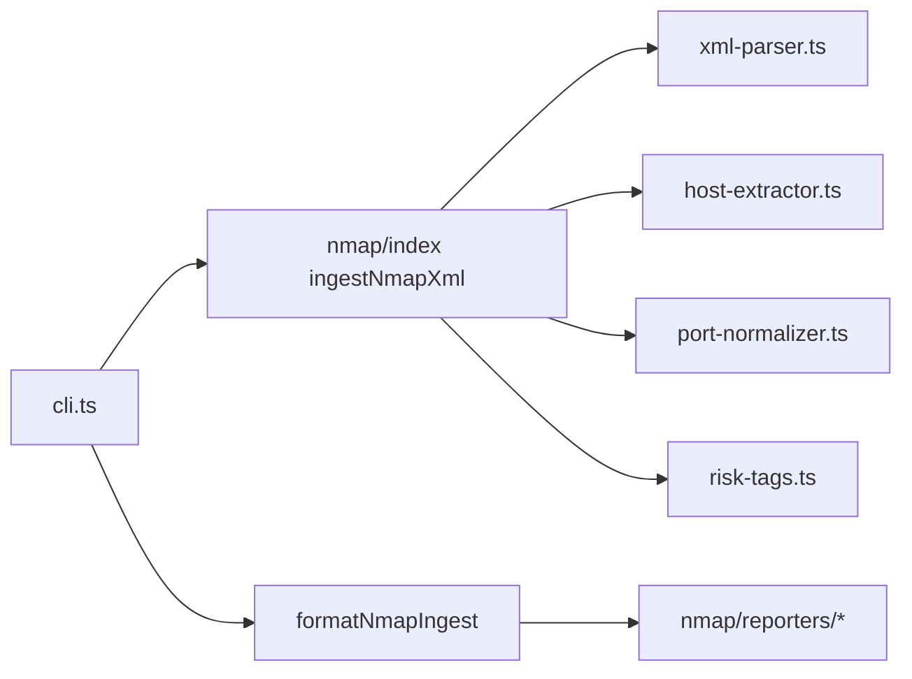

# hx-parse-cli — architecture

## Purpose

Reads Nmap XML scan output from disk, parses hosts, addresses, ports, and service
metadata, then formats results as Markdown, JSON, or CSV for downstream engagement
tooling. Non-goals: running Nmap/Masscan, live scanning, or diffing multiple scans (see
hx-api-diff / hx-graph).

## High-level flow

## Module map

| Path                             | Responsibility                                      |
| -------------------------------- | --------------------------------------------------- |
| `src/cli.ts`                     | `nmap` command, format flags, stdout and `-o` write |
| `src/nmap.ts`                    | Legacy/barrel re-exports                            |
| `src/engagement.ts`              | Engagement document helpers                         |
| `src/nmap/index.ts`              | `ingestNmapXml`, `formatNmapIngest` public API      |
| `src/nmap/xml-parser.ts`         | `fast-xml-parser` Nmap XML → raw structure          |
| `src/nmap/host-extractor.ts`     | Host records from parsed XML                        |
| `src/nmap/port-normalizer.ts`    | Port state and service normalization                |
| `src/nmap/risk-tags.ts`          | Heuristic tags for common exposed services          |
| `src/nmap/types.ts`              | Ingest result types                                 |
| `src/nmap/reporters/index.ts`    | Format dispatcher                                   |
| `src/nmap/reporters/markdown.ts` | Markdown report                                     |
| `src/nmap/reporters/json.ts`     | JSON report                                         |
| `src/nmap/reporters/csv.ts`      | CSV report                                          |

## Extension

1. Extend `port-normalizer.ts` or `risk-tags.ts` for new service fingerprints.
2. Add a reporter under `nmap/reporters/` and wire `formatNmapIngest`.
3. Unit-test with fixture XML files under tests — no live scans.
4. Run `npm test` and `npm run format:check`.

## Testing strategy

- **Unit**: XML parser, host extraction, reporters, risk tags — fixture XML only.
- **Integration**: none required.

## Ethics & scope

Authorized engagements only. See [SECURITY.md](./SECURITY.md).
